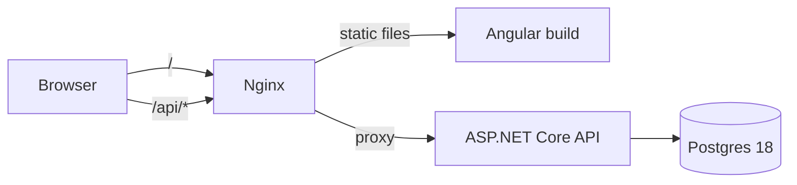
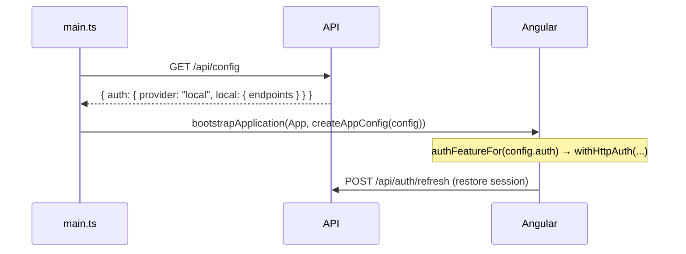
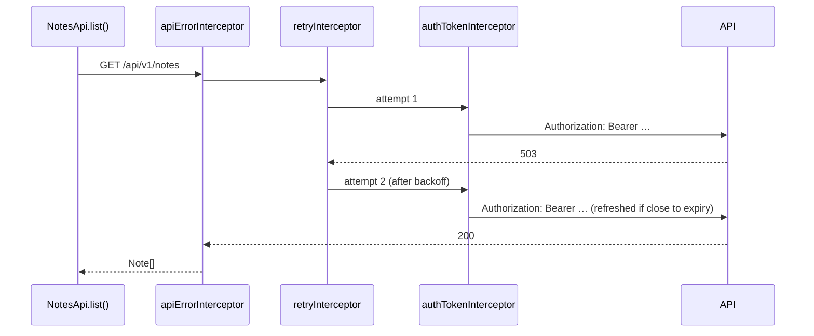

# Architecture

## Runtime



nginx serves the Angular build and proxies `/api` to the API, so **the app and
the API share one origin**. That is what lets the refresh cookie be
`SameSite=Strict` and removes CORS from the picture. In development, `ng serve`
plays nginx's role through `client/proxy.conf.json`.

## Startup



The client asks the server which auth provider is in use **before** Angular
starts, because `provideAuth()` needs its adapter at bootstrap. Switching
provider is therefore a server setting — see [auth-providers.md](auth-providers.md).
If the config can't be loaded, `main.ts` shows a plain error instead of a
half-working app.

## How the two libraries share a request

Every feature call goes through `ApiService` (ngx-api-client). The HTTP
interceptors are registered once, in `client/src/app/core/api/http.ts`, and their order
is the integration:

```ts
withInterceptors([
  apiErrorInterceptor, // outermost: one ApiError per operation, reported once
  apiSuccessInterceptor, // success toast for mutating calls
  retryInterceptor, // retries the raw HttpErrorResponse → must be inside apiErrorInterceptor
  authTokenInterceptor, // innermost (ngx-auth-client): each retried attempt gets a fresh token
]);
```



Other connection points:

- **URLs**: `provideApi({ baseUrl: '' })` produces relative URLs (`/api/v1/notes`).
  `authTokenInterceptor` only attaches the token to URLs matching its allowlist,
  by default `/api/…` on the same origin, so the two line up with no extra
  configuration.
- **Auth calls stay separate**: the auth adapter calls `/api/auth/*` straight
  through `HttpBackend`, bypassing every interceptor, so sign-in and refresh are never
  retried, versioned or toasted.
- **401s**: `ToastApiErrorHandler` (`core/api/api-handlers.ts`) receives every
  `ApiError`. A 401 means the session could not be refreshed, so it calls
  `AuthService.login()`. Validation errors are left to the form that sent them.
- **No empty catch blocks**: an error the handler has shown still rejects the
  caller's promise. `AppErrorHandler` (`core/errors/`) ignores those, so pages
  just `await` the call. A page catches only when it shows the error itself:
  the login form, the profile page, sign-out, register's field errors and the
  playground. Auth calls bypass the interceptors, so no toast reports them.

## Server layout

```
server/
├── NgxLibsDemo.slnx
├── Directory.Build.props        # net10.0, nullable, warnings as errors, analyzers
├── Directory.Packages.props     # central package versions
├── src/Demo.Api/
│   ├── Program.cs               # composition only
│   ├── Auth/
│   │   ├── AuthSetup.cs         # the provider switch
│   │   ├── ClientConfigEndpoint.cs   # GET /api/config
│   │   ├── Local/               # Identity + JWT + rotating refresh cookie
│   │   └── Keycloak/            # JWT validation against the realm + client config
│   ├── Data/                    # DbContext, entities, migrations, seeding
│   ├── Features/                # Notes, Admin, Playground — one folder each
│   └── Infrastructure/          # problem+json writer, rate limiting, paging
└── tests/Demo.Api.Tests/        # WebApplicationFactory + Testcontainers Postgres
```

Feature endpoints never look at the provider: they read `sub` and `roles` from a
validated `ClaimsPrincipal`. Only `Auth/` knows how tokens are issued or validated.

## Client layout

```
client/src/
├── main.ts                      # load runtime config, then bootstrap
└── app/
    ├── app.config.ts            # createAppConfig(runtimeConfig)
    ├── app.routes.ts            # lazy routes; guards from both libraries
    ├── core/
    │   ├── config/              # RuntimeConfig, RUNTIME_CONFIG, loadRuntimeConfig()
    │   ├── auth/                # authFeatureFor() — the adapter switch; route guards
    │   ├── api/                 # provideAppApi(), interceptor chain, error/success handlers
    │   └── notifications/       # toast state
    ├── layout/                  # header, session panel, toasts
    └── features/                # home, auth (login, register), notes, profile, admin, playground, forbidden
```

Conventions:

- Standalone components, `OnPush` by default (Angular 22), signals for state,
  `computed()` for derived state.
- Each component has its own `.ts`, `.html` and, when it has styles, `.css`.
  `styles.css` only holds design tokens, base element styles and shared utilities.
- Each feature that calls the API has its own `*-api.ts` service built on `ApiService`.
- Forms use Signal Forms. Server field errors (`ApiError.errors`) are routed to
  fields from the submission action.
- Pages depend on `AuthService` capabilities (`canSignIn()`, `canRegister()`,
  `canLoadProfile()`), never on a specific adapter.

## Design choices

| Choice | Why |
| --- | --- |
| Access token in memory, refresh token in an `HttpOnly` cookie | XSS cannot read the long-lived credential; the short-lived one never touches storage. |
| Refresh rotation with reuse detection and a 10 s same-client grace window | Stolen-token replay kills the session; two tabs of one browser reloading together don't. |
| Notes keyed by `sub`, not a foreign key to Identity users | Data stays valid when the token issuer becomes Keycloak. |
| Runtime config from the API instead of `environment.ts` | One client build for every provider and environment. |
| Errors written in ngx-api-client's `ProblemDetail` format | `ApiError.errors` is typed as `[{ field, message }]`; ASP.NET's default is a dictionary. |
| Same-origin deployment behind nginx | `SameSite=Strict` cookie, no CORS, no `withCredentials` concerns. |
