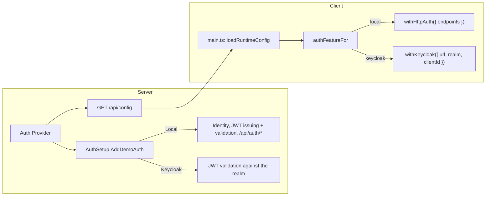

# Auth providers

The server decides **who issues access tokens**; the client follows. One
setting switches both:

```jsonc
// server/src/Demo.Api/appsettings.json — or Auth__Provider / AUTH_PROVIDER in .env
"Auth": { "Provider": "Local" }   // Local | Keycloak
```

| `Auth:Provider` | Token issuer | Client adapter | Status |
| --- | --- | --- | --- |
| `Local` | This API (ASP.NET Core Identity + JWT) | `withHttpAuth()` | Implemented |
| `Keycloak` | A Keycloak 26.8 realm (`keycloak/demo-realm.json`) | `withKeycloak()` | Implemented |

## How the switch works



**Server** — `Auth/AuthSetup.cs` is the only switch:

- `AddDemoAuth()` registers the provider's authentication and the shared
  `admin` policy (`RequireRole("admin")` on the `roles` claim).
- `MapDemoAuth()` maps `GET /api/config`, plus `/api/auth/*` for Local.
- `GET /api/config` returns what the client needs:

  ```json
  { "auth": { "provider": "local", "local": { "endpoints": { "signIn": "/api/auth/login", "refresh": "…", "logout": "…", "profile": "…", "register": "…" } } },
    "features": { "admin": true, "signUpForm": true } }
  { "auth": { "provider": "keycloak", "keycloak": { "url": "http://localhost:8180", "realm": "demo", "clientId": "demo-web" } },
    "features": { "admin": false, "signUpForm": false } }
  ```

**Client** — `core/auth/auth-feature.ts` is the only switch:
`authFeatureFor(config.auth)` returns the `AuthFeature` passed to
`provideAuth()`. Nothing else imports an adapter.

### What is already provider-agnostic

- **Feature endpoints** read `sub` (`ClaimsPrincipal.GetUserId()`) and `roles`.
  Notes are keyed by `sub` with no foreign key to Identity's user table.
- **Pages** use capabilities instead of the adapter type:
  - "Sign in" calls `auth.login()`. The HTTP adapter navigates to `/login`;
    Keycloak redirects to the realm.
  - "Create account" calls `auth.register()` when `canRegister()` (Keycloak),
    or else links to the app's own form (Local).
  - `/login` is only routed when `canSignIn()`; `/register` and `/admin` only
    when `features.signUpForm` / `features.admin` say the API serves them.
  - The profile page checks `canLoadProfile()`.
- **ngx-api-client** is unaffected: `authTokenInterceptor` adds whichever
  adapter's token to `/api` calls.

### What stays Local-only

- `/api/auth/*` (login, refresh, logout, me, register) and the sign-up page.
- The **Admin** page (`/api/v1/admin/*`): it lists Identity users and revokes
  refresh tokens. With Keycloak, users and sessions are managed in Keycloak, so
  these endpoints and the route are not mapped.

## Keycloak

### Run it

Docker (whole stack), in `.env`:

```bash
AUTH_PROVIDER=Keycloak
COMPOSE_PROFILES=keycloak   # required: without it Keycloak doesn't start
```

then `docker compose up --build`. If Keycloak can't be reached, the API logs an
error at startup (after retrying for about 30 s) and `/api/health` answers `503`.
To serve the app or Keycloak elsewhere, set `APP_URL` (the realm's redirect URI,
read on first import) and `KEYCLOAK_URL` (the token issuer, used by both Keycloak
and the API). App on <http://localhost:8080>, Keycloak on
<http://localhost:8180> (admin console: `kcadmin` / `kcadmin`, from
`KEYCLOAK_ADMIN` / `KEYCLOAK_ADMIN_PASSWORD`).

Hot reload:

```bash
docker compose up -d db keycloak            # naming a profiled service starts it
Auth__Provider=Keycloak dotnet run --project server/src/Demo.Api
cd client && npm start                      # http://localhost:4200
```

`appsettings.Development.json` already points at `http://localhost:8180`.

### Compose services (`keycloak` profile)

| Service | What |
| --- | --- |
| `keycloak-db` | Postgres 18, database `keycloak`, own volume `keycloak-db-data`. Separate from the API's `db`. |
| `keycloak` | `quay.io/keycloak/keycloak:26.8`, `start-dev --import-realm`, port `8180`. Health on the management port (`9000/health/ready`). |

The realm is imported on the first start only (`IGNORE_EXISTING`). After editing
`keycloak/demo-realm.json`, reset with `docker compose down` and
`docker volume rm ngx-libs-demo_keycloak-db-data`.

`KC_HOSTNAME=http://localhost:8180` fixes the token issuer to the browser's URL,
and `KC_HOSTNAME_BACKCHANNEL_DYNAMIC=true` lets the API fetch keys from
`http://keycloak:8080` on the Compose network.

### Realm `demo`

| Item | Value |
| --- | --- |
| Client `demo-web` | Public, standard flow only, PKCE `S256` required, redirect URIs `${APP_URL}/*` (default `http://localhost:8080`) and `http://localhost:4200/*`, web origins `+` |
| Realm roles | `user`, `admin`. `default-roles-demo` includes `user` and the `account` roles, so self-registered users get `user` and can load their profile |
| Users | `alice` (`user`), `admin` (`user`, `admin`), password `Passw0rd!` |
| Mapper "api audience" | Adds `demo-api` to the access token's `aud` |
| Mapper "realm roles as roles" | Copies realm roles into a top-level `roles` array — the claim the API's `admin` policy and the Local provider already use |
| Settings | Self-registration on, brute-force protection (5 failures), access tokens 5 minutes |

Keycloak substitutes `${APP_URL:default}` placeholders when it imports the file.

An access token for alice:

```json
{
  "iss": "http://localhost:8180/realms/demo",
  "aud": ["demo-api", "account"],
  "sub": "9824a1a9-…",
  "azp": "demo-web",
  "preferred_username": "alice",
  "roles": ["offline_access", "uma_authorization", "default-roles-demo", "user"],
  "realm_access": { "roles": ["…same…"] },
  "resource_access": { "account": { "roles": ["manage-account", "view-profile", "…"] } }
}
```

### Server

`Auth/Keycloak/KeycloakAuthSetup.cs` only **validates** tokens; it issues none.

| Setting (`Auth:Keycloak:…`) | Default | Notes |
| --- | --- | --- |
| `Url` | — (`http://localhost:8180` in Development and Compose) | Public URL. `{Url}/realms/{Realm}` is the required `iss` |
| `InternalUrl` | `Url` | Where the API fetches the discovery document and keys (`http://keycloak:8080` in Compose) |
| `Realm` / `ClientId` / `Audience` | `demo` / `demo-web` / `demo-api` | `ClientId` is only passed to the client via `/api/config` |
| `RequireHttpsMetadata` | `true` (`false` in Development and Compose) | In Compose, keys always come from `http://keycloak:8080` on the private network, even when `KEYCLOAK_URL` is HTTPS |

Validation: issuer, audience `demo-api`, RS256 only, lifetime with 30 s skew,
claims kept as issued (`sub`, `roles`, `preferred_username`). Lifetime is checked
against the system clock (`JwtBearerOptions.TimeProvider` doesn't apply to it), so
tests mint tokens with real time. With this provider `/api/auth/*` and
`/api/v1/admin/*` are not mapped (404), and no Identity data is seeded.

`KeycloakReachability` fetches the discovery document: once at startup with
retries (`KeycloakStartupProbe`, logs an error naming `COMPOSE_PROFILES`), and on
every `/api/health` call.

### Client

`core/auth/auth-feature.ts`:

```ts
withKeycloak({
  url, realm, clientId,               // from /api/config
  onLoad: 'check-sso',
  silentCheckSsoRedirectUri: new URL('silent-check-sso.html', document.baseURI).href,
  postLogoutRedirectUri: new URL('./', document.baseURI).href,
  roles: { realm: true, resource: false },
});
```

- `public/silent-check-sso.html` restores the session on reload in a hidden
  iframe instead of a full redirect. `localhost:8080` and `localhost:8180` are the
  same site, so Keycloak's SSO cookie reaches the iframe.
- `resource: false` keeps Keycloak's own `account` client roles out of
  `auth.roles()`.
- Capabilities light up without adapter checks: "Sign in" redirects to Keycloak,
  "Create account" opens its registration page (`canRegister()`), and the profile
  page loads the profile from Keycloak's account API and shows "Manage account"
  (`canManageAccount()`) and "Change password" (`canUpdatePassword()`).
- The Admin link and the `/admin` and `/register` routes follow `features` from
  `/api/config`, which are both `false` here.
- If the account or password page can't be opened, the profile page shows the
  error itself: it isn't an `ApiError`, so no toast would report it.
- `authTokenInterceptor` is unchanged; it now attaches the Keycloak token to `/api` calls.

### Tests

- `server/tests/Demo.Api.Tests/KeycloakAuthTests.cs` runs the API with
  `Auth:Provider=Keycloak` against a test RSA key, with tokens shaped like the
  realm's: config block and features, notes keyed by `sub`, wrong audience /
  issuer / key and expired tokens rejected, Local-only endpoints not mapped,
  `/api/health` reporting an unreachable Keycloak. One host for the class.
- `client/src/app/core/auth/auth-feature.spec.ts`: the resolved `withKeycloak()`
  options (realm, `check-sso`, silent SSO and logout URLs under the base href,
  realm roles only).
- `client/src/app/core/auth/route-guards.spec.ts`: `/admin` and `/register` only
  match when their feature is on.
- The realm itself (mappers, PKCE, CORS, account API, registration) was checked by
  hand against Keycloak 26.8.1; there is no automated Keycloak container test.
