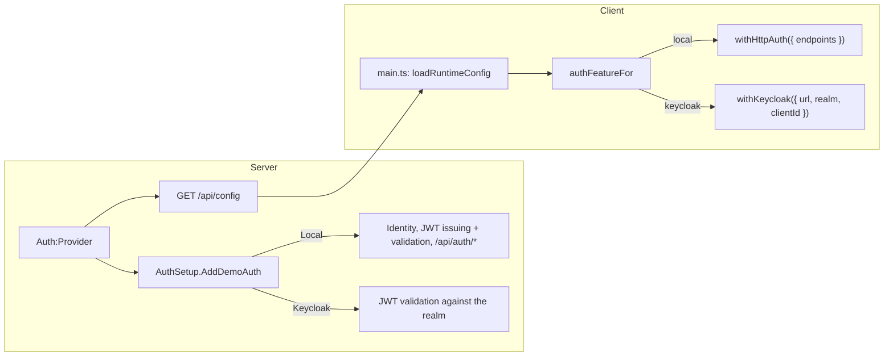

# Auth providers

The server decides **who issues access tokens**; the client follows. One
setting switches both:

```jsonc
// server/src/Demo.Api/appsettings.json — or Auth__Provider / AUTH_PROVIDER in .env
"Auth": { "Provider": "Local" }   // Local | Keycloak
```

| `Auth:Provider` | Token issuer | Client adapter | Status |
| --- | --- | --- | --- |
| `Local` | This API (ASP.NET Core Identity + JWT) | `withHttpAuth()` | Implemented |
| `Keycloak` | A Keycloak realm | `withKeycloak()` | Planned, wired as a stub |

## How the switch works



**Server** — `Auth/AuthSetup.cs` is the only switch:

- `AddDemoAuth()` registers the provider's authentication and the shared
  `admin` policy (`RequireRole("admin")` on the `roles` claim).
- `MapDemoAuth()` maps `GET /api/config`, plus `/api/auth/*` for Local.
- `GET /api/config` returns what the client needs:

  ```json
  { "auth": { "provider": "local", "local": { "endpoints": { "signIn": "/api/auth/login", "refresh": "…", "logout": "…", "profile": "…", "register": "…" } } } }
  { "auth": { "provider": "keycloak", "keycloak": { "url": "http://localhost:8180", "realm": "demo", "clientId": "demo-web" } } }
  ```

**Client** — `core/auth/auth-feature.ts` is the only switch:
`authFeatureFor(config.auth)` returns the `AuthFeature` passed to
`provideAuth()`. Nothing else imports an adapter.

### What is already provider-agnostic

- **Feature endpoints** read `sub` (`ClaimsPrincipal.GetUserId()`) and `roles`.
  Notes are keyed by `sub` with no foreign key to Identity's user table.
- **Pages** use capabilities instead of the adapter type:
  - "Sign in" calls `auth.login()`. The HTTP adapter navigates to `/login`;
    Keycloak redirects to the realm.
  - "Create account" calls `auth.register()` when `canRegister()` (Keycloak),
    or else links to the app's own form (Local).
  - `/login` is only routed when `canSignIn()`; `/register` and `/admin` only
    with the Local provider.
  - The profile page checks `canLoadProfile()`.
- **ngx-api-client** is unaffected: `authTokenInterceptor` adds whichever
  adapter's token to `/api` calls.

### What stays Local-only

- `/api/auth/*` (login, refresh, logout, me, register) and the sign-up page.
- The **Admin** page (`/api/v1/admin/*`): it lists Identity users and revokes
  refresh tokens. With Keycloak, users and sessions are managed in Keycloak, so
  these endpoints and the route are not mapped.

## Keycloak: implementation plan

Selecting `Keycloak` today stops the API at startup with
`NotSupportedException: Auth:Provider 'Keycloak' is not implemented yet`, and
`authFeatureFor()` throws on the client, so a half-configured app never runs.

### Server

1. **Settings** (already defined in `Auth/Keycloak/KeycloakAuthSetup.cs`):

   ```json
   "Auth": {
     "Provider": "Keycloak",
     "Keycloak": { "Url": "http://localhost:8180", "Realm": "demo", "ClientId": "demo-web", "Audience": "demo-api" }
   }
   ```

2. **Token validation**, in `AddKeycloakAuth()` in place of the `throw`:

   ```csharp
   services.AddAuthentication(JwtBearerDefaults.AuthenticationScheme).AddJwtBearer(o =>
   {
       o.Authority = $"{options.Url}/realms/{options.Realm}";
       o.Audience = options.Audience;
       o.MapInboundClaims = false;
       o.TokenValidationParameters.NameClaimType = "preferred_username";
       o.TokenValidationParameters.RoleClaimType = "roles";
       o.RequireHttpsMetadata = !environment.IsDevelopment();
   });
   ```

   In Docker the API reaches Keycloak as `http://keycloak:8080` while the
   browser uses `http://localhost:8180`. Set `MetadataAddress` to the internal
   URL and `ValidIssuer` to the public one.

3. **Roles**: Keycloak puts realm roles in `realm_access.roles`. Either add an
   `IClaimsTransformation` that copies them into `roles` claims, or add a
   "User Realm Role" protocol mapper on the client with claim name `roles`
   (multivalued). The mapper needs no code and also helps the Angular side.

4. **Audience**: add an "Audience" mapper so access tokens carry `aud: demo-api`.

5. **Seeding**: `MigrateAndSeedAsync()` already skips Identity users and roles
   for non-Local providers. Create `alice` and `admin` in a realm export instead.

### Docker Compose

Add a `keycloak` service (e.g. `quay.io/keycloak/keycloak` in `start-dev
--import-realm` mode) on port `8180`, mount `keycloak/demo-realm.json` (realm,
public client `demo-web` with PKCE and redirect URI `http://localhost:8080/*`,
roles `user`/`admin`, users, the mappers above), and set `AUTH_PROVIDER=Keycloak`.

### Client

1. `npm i keycloak-js` (an optional peer of ngx-auth-client).
2. In `authFeatureFor()`, replace the `throw`:

   ```ts
   import { withKeycloak } from '@ismailza/ngx-auth-client/keycloak';

   case 'keycloak':
     return withKeycloak({
       url: config.keycloak.url,
       realm: config.keycloak.realm,
       clientId: config.keycloak.clientId,
       onLoad: 'check-sso',
     });
   ```

3. If silent SSO is used, add `public/silent-check-sso.html` and pass
   `silentCheckSsoRedirectUri`.
4. Update the `authFeatureFor` spec: the Keycloak case should now return
   `kind: 'keycloak'`.

### Tests to add

- Server: an `ApiFactory` variant with `Auth:Provider=Keycloak` and a test
  signing key (or a Keycloak Testcontainer), checking that `/api/auth/*` and
  `/api/v1/admin/*` are not mapped and that `/api/config` returns the Keycloak block.
- Client: the header shows "Create account" through `register()` when
  `canRegister()` is true.
